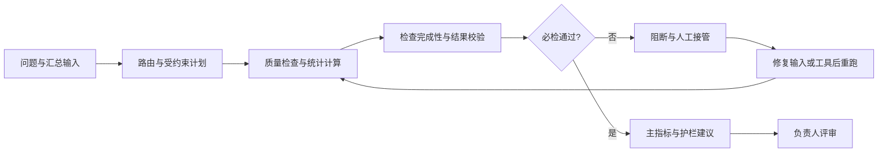

# ExperimentOS｜电商实验上线评审助手

面向增长 PM 的**可复核离线原型**。当前使用合成数据，帮助准备商品详情页 A/B 实验的人工上线评审材料；必检未完成时，明确阻断、接管角色与重跑条件。

[](https://github.com/IfiniteAurora13/experiment-analysis-agent/actions/workflows/ci.yml)

## 1. 用户与任务

目标用户是已有实验平台或数据导出渠道、需要协调分析师准备上线评审的电商增长 PM。

聚焦两组、用户级随机、固定周期的商品详情页改版实验。目标指标是 7 天支付用户转化率，护栏是 7 天支付 GMV / 入组用户。**当前代码接受已有汇总输入；上述原始数据口径尚未通过导入流程强制验证，属于下一阶段交付。**

输出评审建议与证据，由业务负责人确认执行。用户调研、生产接入和业务收益尚未验证。

## 2. 非 AI 基线与 Agent 的必要性

现有默认模式就是规则工作流：质量检查 → 统计计算 → 结果校验 → 建议 → 固定报告，不调用模型。它是对照基线。

LLM 后续应证明的增量是跨材料核对口径、提出最关键的补证问题、选择受约束的恢复路径，而非计算统计结果。结构化输入已齐全时，优先使用规则基线。**当前尚无 Agent 优于基线的实测证据。**

## 3. 一个已经复现并修复的失败

模拟质量检查不可用，同时保留核心指标显著提升、护栏持平：

| 版本 | 行为 |
| --- | --- |
| 修复前 | 总状态提示 concerns，但仍建议“小流量灰度或继续推进发布评审” |
| 当前 | 质量检查为 UNKNOWN，评审为 BLOCKED；不调用建议工具，输出接管与重跑条件 |

[完整 Bad Case 与复现方法](bad_cases/BC005_quality_check_unavailable.md) · [修复前原始输出](bad_cases/evidence/BC005_before.json) · [修复后报告](bad_cases/evidence/BC005_after.md)

这是**合成故障注入**，不是生产事故或真实用户研究。

## 4. 当前实现与边界

| 状态 | 内容 |
| --- | --- |
| 已实现 | 当前内置质量检查、统计计算、结果校验的 PASS / FAIL / UNKNOWN；必检异常或缺失时阻断发布建议 |
| 已实现 | 检查全部输入指标是否产出对应结果；可选分群失败允许保留总体结果 |
| 已实现 | 被阻断的报告使用固定模板，计算结果仅供排障，并显示接管角色和重跑条件 |
| 尚未实现 | 原始数据导入契约、口径确认、数据成熟度与迟到处理、版本签字与撤回 |
| 尚未验证 | 正常 READY 报告的真实 LLM 叙述保真度、用户任务收益、线上数据源可用性 |

READY 仅表示**当前三项内置必检**通过，不代表数据全链路可信、不代表护栏安全，也不代表批准上线。

## 5. 评测证据

当前离线评测 **12 / 12 场景通过**，其中新增 8 例检查必检失败、结果缺失、非法统计返回、可选分析降级及正常路径。

[逐例评测报告](evals/reports/step1.md) · [案例输入与预期](evals/cases/E005_E012_review_readiness.json) · [回归测试](tests/test_review_gate.py)

默认 Eval 不调用真实模型，新增 release_safety 检查最终模板文案。被阻断报告跳过模型重写另有回归验证。**12 例不代表线上可靠性，也不代表完成真实 LLM 端到端评测。**

## 6. 保留与取舍

保留确定性统计内核、质量检查、来源标记、Trace 和现有单元测试。分群只用于探索；驱动拆解目前是公式框架，不宣传自动归因。

暂停扩展 CUPED、贝叶斯、序贯检验、多 Agent、任意 SQL、更多数据源和自动上线。固定周期结束仍证据不足时，应明确不确定性，不能为得到显著结果持续延长实验。

旧浏览器页保留为统计示意，不生成发布建议、不把未执行检查显示为通过。完整工作流以 Python 实现为准。

## 7. 下一步

[产品场景、基线与验收方式](product/brief.md) · [分阶段路线与完成状态](product/roadmap.md)

下一步优先做固定导出包的数据契约与脏数据回放，再扩展分层评测和三条完整 Demo。用户研究与真实模型结果须单独记录来源，不能用计划替代成果。

## 快速开始

需要 Python 3.11+。

```bash
git clone https://github.com/IfiniteAurora13/experiment-analysis-agent.git
cd experiment-analysis-agent
python3 -m venv .venv
. .venv/bin/activate
python -m pip install -e '.[dev]'
```

运行规则基线：

```bash
python -m experimentos.app.cli examples/product_detail_release.json --llm off --trace
```

复现“质量检查失败”的人工接管流程：

```bash
python -m evals.replay_quality_failure
```

打开本地工作台：

```bash
streamlit run experimentos/app/streamlit_app.py
```

测试与离线 Eval（失败时退出码非零）：

```bash
python -m pytest -q
python -m evals.runner --no-write
```

## 工作流



工具异常、结果无效、业务建议分别记录；不能用空问题列表替代成功执行的质量检查。

## 统计能力

| 能力 | 实现与限制 |
| --- | --- |
| 内置质量检查 | SRM、样本量与时长提示；尚无原始数据完整性保证 |
| 转化指标 | Pooled two-proportion z-test + Wald CI；适用性边界仍需扩展评测 |
| 连续指标 | Welch t-test + Welch–Satterthwaite df |
| 外部汇总统计 | 保留来源标记，不据此承诺来源已审计 |
| 分群 | BH-FDR；探索性发现需独立验证 |
| 发布策略 | 当前仍为静态规则；允许损失界值与分级策略待实现 |

## 浏览器统计示意

[旧版统计示意页](https://ifiniteaurora13.github.io/experiment-analysis-agent/)使用浏览器近似计算。它不调用 Agent，不执行 SRM、数据质量或成熟度检查，不提供上线建议。新分支的页面修改须合并部署后才会反映在线上。

## 数据边界

CI 与 Eval 仅使用合成 fixture 和离线故障注入，不访问真实业务数据。线上数据源默认关闭。接管角色是本地流程说明，尚未实现企业身份、权限控制或真实发布控制。

## 项目结构

```text
product/          用户任务、非 AI 基线与分阶段路线
experimentos/     确定性分析、必检门禁、应用与可选 LLM
evals/            离线案例、最终模板文案检查与回放
bad_cases/        失败记录及修复前后证据
examples/         合成输入
metric_specs/     指标与分群定义
docs/            浏览器统计示意
tests/           单元及工作流回归
```

## License

Internal / personal project for learning and experimentation.
